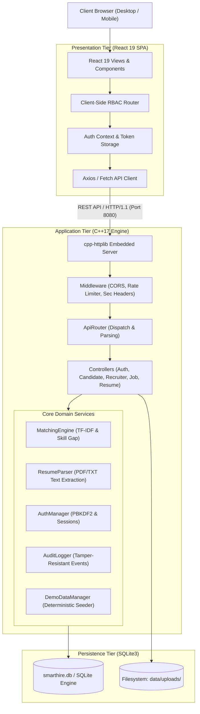
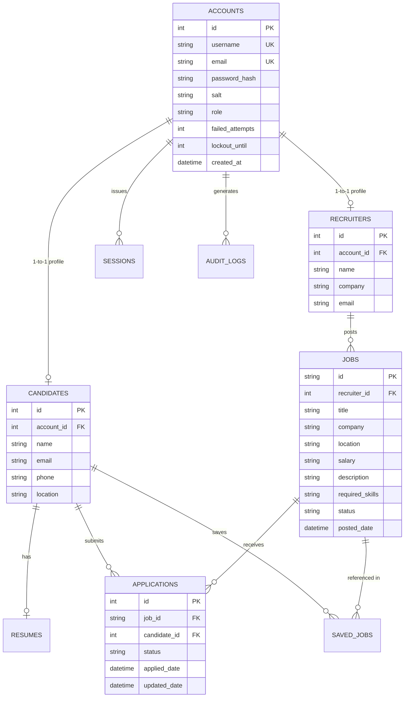

# SmartHire — Architectural Architecture & System Design

**Version:** 11.0 (Production Ready)  
**System Classification:** Offline-First Intelligent Recruitment Platform  
**Target Environment:** Local & Self-Hosted Multi-Tier Architecture  

---

## 1. Executive Summary

SmartHire is a multi-tier, offline-capable recruitment automation and intelligent candidate-job matching platform. Built using **C++17** for high-throughput, low-latency analytical computation and **React 19 (Vite)** for a modern user experience, SmartHire operates completely self-contained without mandatory cloud dependencies or external third-party AI APIs.

### Key Architectural Pillars
- **Authoritative C++ Backend:** All business logic, matching algorithms, cryptographic operations, access control, and persistence are strictly enforced in C++17.
- **Deterministic Explainable AI:** Matching is powered by an explainable, deterministic vector-space TF-IDF model and semantic skill-ontology analysis.
- **Zero-Cloud Local Resilience:** Complete offline operation with zero telemetry, zero mandatory cloud egress, and an embedded SQLite storage engine.
- **Defense-in-Depth Security:** Cryptographically secure PBKDF2-HMAC-SHA256 password hashing, tokenized bearer sessions, strict RBAC, and input sanitization at every boundary.

---

## 2. High-Level System Architecture

SmartHire follows a decoupled multi-tier architecture communicating over an HTTP/1.1 RESTful JSON protocol.

---

## 3. Tier-by-Tier Architectural Breakdown

### 3.1 Presentation Tier (Frontend SPA)
- **Framework:** React 19.x with Vite 8 tooling.
- **Routing:** Client-side role-based routing (`CandidateLayout`, `RecruiterLayout`, `ProtectedRoute`).
- **State Management:** React Context API for authentication state (`AuthContext`), persistent session synchronization with `localStorage`, and reactive component state.
- **Design System:** Vanilla CSS design token system with glassmorphic cards, fluid typography, dark-mode styling, and accessible contrast ratios.
- **Error Handling:** Standardized API error interceptor rendering user-friendly notifications with error-code mapping.

### 3.2 Transport & Routing Tier (C++ REST Gateway)
- **Embedded Web Server:** `cpp-httplib` v0.58.0 multithreaded socket server listening on configurable host and port (default: `127.0.0.1:8080`).
- **Middleware Pipeline:**
  1. **Security Headers Middleware:** Emits `X-Content-Type-Options: nosniff`, `X-Frame-Options: DENY`, `X-XSS-Protection: 1; mode=block`, and strict caching policies.
  2. **CORS Middleware:** Configurable origin reflection supporting preflight `OPTIONS` requests with allowed headers (`Authorization`, `Content-Type`).
  3. **Rate Limiting Middleware:** Sliding-window IP rate limiter restricting authentication and write-intensive routes to prevent brute-force attacks.
  4. **Request Logging:** Operational logging tracking method, path, response status, and processing duration.
- **Routing Engine (`ApiRouter`):** Matches URL routes and HTTP verbs to controller handler functions, extracting path variables (e.g., `/api/v1/jobs/:id`) and parsing multipart payloads.

### 3.3 Domain Services & Intelligence Tier
- **Explainable Matching Engine (`MatchingEngine`):**
  - **Vector Space Representation:** Implements an in-memory Term Frequency-Inverse Document Frequency (TF-IDF) vectorizer.
  - **Cosine Similarity:** Computes normalized vector angles between candidate profile documents and job requisition specifications.
  - **Skill-Gap Decomposition:** Evaluates candidate skills against mandatory and preferred job skills, yielding matched skills, missing critical skills, and an explainability score breakdown.
- **Career Intelligence & Analytics Engine (`AnalyticsService` - Phase 12):**
  - **Career Readiness Indicators:** Evaluates deterministic metrics (Readiness Index, Readiness Tier, Skill Coverage, Experience Alignment, Education Alignment, Profile Completeness) with natural language diagnostic factors.
  - **Skill Gap Demand Analytics:** Analyzes missing candidate competencies classified by job requirement type (`REQUIRED` vs `PREFERRED`) weighted by market demand frequency across open requisitions.
  - **Job Market Insights & Skill Co-occurrence:** Analyzes the active job database to compute top in-demand skills, geographic concentration, employment-type distributions, and deterministic skill co-occurrence pairs without external APIs.
  - **Explainable Job Recommendation Engine:** Multi-factor ranking combining skill coverage, semantic TF-IDF overlap, and experience satisfaction with explicit human-readable reasons (e.g., "✓ 8/10 required skills matched").
  - **Resume-to-Job Detailed Comparison:** Side-by-side breakdown comparing candidate qualifications against specific job expectations.
  - **Recruiter Hiring Analytics & Pipeline Funnel:** Recruiter-specific analytics aggregating active postings, applicant stages (`APPLIED` → `UNDER_REVIEW` → `SHORTLISTED` → `INTERVIEW` → `SELECTED`), and a 5-tier applicant match score histogram.
  - **Factual Candidate Comparison Matrix:** Tabular comparison of applicants for a requisition (scores, required skill counts, experience years, current stages) empowering human recruiters to make informed final decisions.
- **Document Ingestion (`ResumeParser`):**
  - High-resilience parsing of plain text (`.txt`) and basic PDF text stream tokens.
  - Regular-expression normalization extracting email, telephone numbers, linked skills from `skill_dictionary.txt`, education history, and employment chronologies.
- **Authentication & RBAC Manager (`AuthManager`):**
  - Passwords processed with 100,000 PBKDF2 iterations using HMAC-SHA256 and unique 16-byte random salts (verified in Test 238).
  - Session tokens generated using 32 bytes of cryptographic randomness, stored in SQLite as SHA-256 hashes to prevent token database leakage.
  - Strict role enforcement distinguishing `CANDIDATE` and `RECRUITER` identities and preventing horizontal privilege escalation (User A cannot view User B's private resources).
- **Demo Data Manager (`DemoDataManager`):**
  - Fully idempotent sample data generator providing deterministic test accounts, pre-indexed job listings, structured resumes, and multi-stage candidate applications.

### 3.4 Persistence Tier (SQLite & Local Storage)
- **Database Engine:** SQLite 3.x embedded within the binary, operating in Write-Ahead Logging (WAL) or standard journal mode.
- **Connection Management (`DatabaseManager`):** Centralized wrapper managing prepared statements (`sqlite3_prepare_v2`), step execution, parameterized binds, and transactional safety.
- **Storage Subsystem:** Document uploads stored in sanitized filesystem directories (`data/uploads/`) with auto-generated UUID filenames, preventing directory traversal vulnerabilities.

---

## 4. Entity-Relationship Schema

The SQLite schema enforces referential integrity through foreign keys and cascading rules.

---

## 5. Security & Isolation Architecture

1. **Horizontal Tenant Isolation:** Controllers compare the authenticated account ID against the target entity's owner ID (`recruiter_id` or `candidate_id`). If IDs do not match, the system rejects the operation with `403 FORBIDDEN_NOT_OWNER`.
2. **Vertical Privilege Enforcement:** Routes are guarded by role guards. For example, any attempt by a `CANDIDATE` to invoke `/api/v1/recruiter/*` returns `403 FORBIDDEN_RECRUITER_ONLY`.
3. **Storage Sanitization:** Uploaded filenames are stripped of directories (`..`, `/`, `\`) and stored using unique hex identifiers with validated `.txt` or `.pdf` extensions.

---

## 6. Resilience & Diagnostic Subsystems

- **Liveness Probe (`/api/v1/health/live`):** Verifies the process is actively servicing socket requests with millisecond response time.
- **Readiness Probe (`/api/v1/health/ready`):** Executes an active database ping (`SELECT 1`) and verifies write access to the configured upload directory.
- **Configuration Management:** Hierarchical configuration resolution:
  `Command-line Flags` > `Environment Variables` > `config/server.conf` > `Compiled Defaults`.
